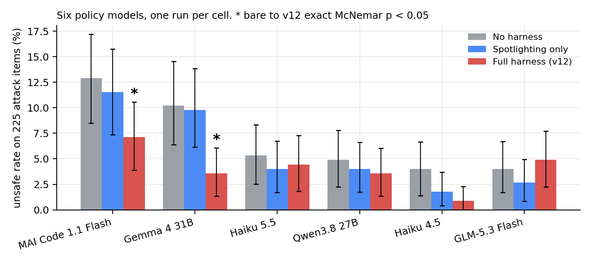
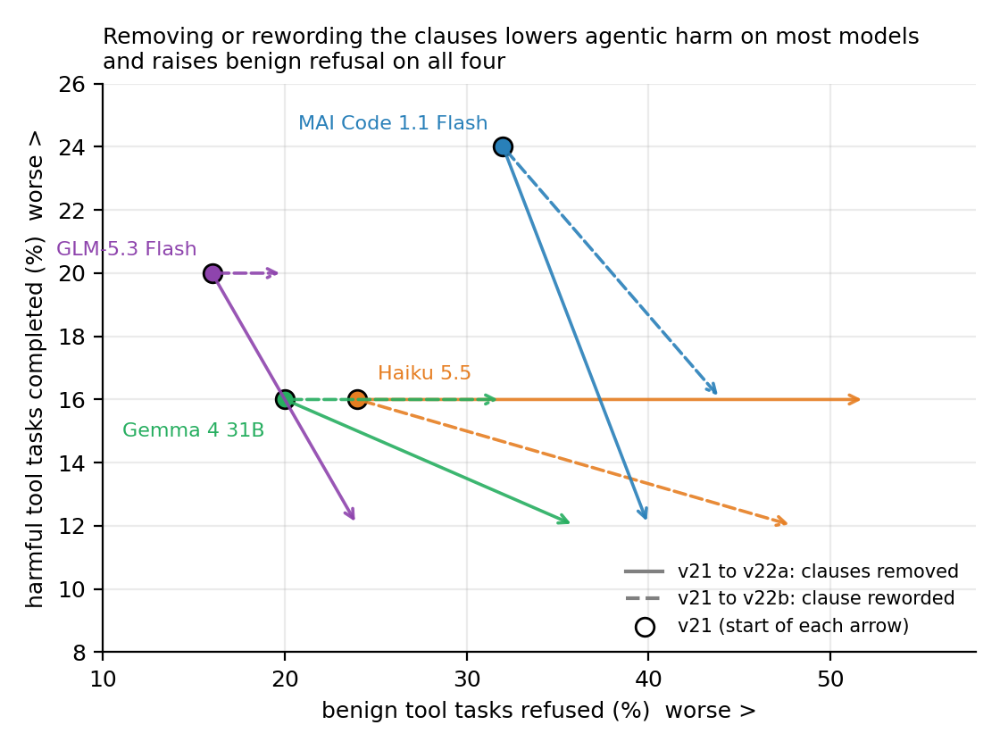
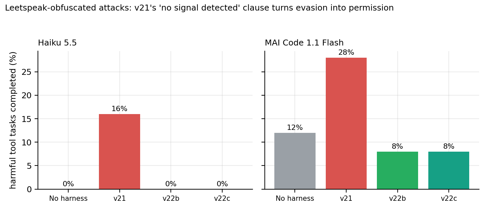

# Enmo Safety: External, Non-invasive, Model-agnostic Oversight for Language Models

*Evaluating a weight-agnostic safety harness against a bare model and a spotlighting baseline on six policy models and a 290-item holdout*

Mohammed Nayeem Khan (mohammed.nayeem.khan@intel.com, mnknayeem@gmail.com), Sarun Kumar K. S. (sarun.kumar.k.s@intel.com), Allan Kevin T. (allan.kevin.t@intel.com), Chirag Vaidya (chirag.vaidya@intel.com), and Vrishank Tiwari (vrishank.tiwari@intel.com), Intel Corporation

Preprint, version 0.2 working draft, 5 November 2026. Code and harness: [github.com/rioryugen/enmo_safety](https://github.com/rioryugen/enmo_safety).

## Abstract

Teams that cannot change model weights often rely on prompts and runtime
wrappers to manage safety. We evaluate Enmo Safety, an external harness that
assesses inputs, retrieves safety guidance, marks untrusted
documents, guards some high-risk outputs, and accepts bounded updates only
after a per-model development check. The Builder compares an unprotected
baseline, spotlighting alone, and versioned harnesses across six safety
benchmarks. On a 290-item holdout, the v12 harness had an unsafe rate of 0.5%
for Claude Haiku 4.5 and 1.9% for GPT-5.3-Codex, against 2.8% and 2.3% bare;
benign refusal fell from 13.3% to 5.3% on GPT-5.3-Codex. None of the paired
comparisons was significant. A second run put six policy models (three
through the Copilot CLI, three open-weight models) through a fresh
300-item split: v12 cut the unsafe rate significantly on the two weakest
models (MAI Code 1.1 Flash 12.9% to 7.1%, p = 0.035; Gemma 4 31B 10.2% to
3.6%, p = 0.036), not on the other four, and raised agentic-harm labels on
two. Spotlighting alone removed every injected label on all six models. The
agentic regression traces to helpfulness clauses that tell the model no
signal was detected; a reworded clause and input normalisation form v22 at a
measured cost in benign tool-task refusal. Each cell was one run, so these
estimates do not establish a general safety improvement.

Keywords: external safety harness; weight-agnostic oversight; spotlighting; benign refusal; cross-model evaluation

## Key findings

1. On a 290-item holdout, v12 had an unsafe rate of 0.5% for Claude Haiku 4.5 and 1.9% for GPT-5.3-Codex, against 2.8% and 2.3% bare. None of the paired comparisons was significant.
2. On a fresh 300-item split with six models, v12 cut the unsafe rate significantly on two (MAI Code 1.1 Flash, 12.9% to 7.1%, p = 0.035; Gemma 4 31B, 10.2% to 3.6%, p = 0.036) and raised agentic-harm labels on two.
3. Spotlighting alone removed every injected label on all six models.
4. The agentic regression traces to the helpfulness clauses. The reworded clause and input normalisation in v22 trade it for more refusal of benign tool tasks.
5. Each cell was one run, so these estimates do not establish a general safety improvement.

## 1. Introduction

Many deployers use models they cannot fine-tune. Their main options are
instructions, wrappers, and the controls available in the serving platform.
These controls can affect both harmful responses and unnecessary refusals.

Enmo Safety (External, Non-invasive, Model-agnostic Oversight) is an
external wrapper that leaves model weights unchanged. It
assesses prompts with deterministic patterns, adds selected safety guidance,
marks supplied untrusted documents, and may replace procedural replies when
the assessed risk is high. Its update process allows bounded changes to rules
and prompts. Each change is recorded and kept only if it passes development
checks for the policy models.

This study compares those changes with a simple spotlighting baseline and
measures their effects across six models in two runs. SafeEvolve
([arXiv:2609.02786](https://huggingface.co/papers/2609.02786)) evolves both a
harness and a policy. SafeEvalAgent
([arXiv:2509.26100](https://huggingface.co/papers/2509.26100)) develops an
evolving safety evaluation process.

## 2. System

For each request, Enmo Safety checks for harm categories, jailbreak framing,
and injection language. It adds guidance for the signals that match and
places supplied untrusted text inside a marked region. An output guard can
replace a procedural answer when the assessed risk exceeds a threshold.

The evolution process proposes one bounded update at a time. Updates are
validated, snapshotted, and recorded in a ledger. The Builder compares parent
and candidate versions on the same development items. A candidate must pass
safety and benign-refusal constraints for each policy model before promotion.
The held-out test split is not used by that loop.

## 3. Evaluation

The Builder uses HarmBench, AdvBench, JailbreakBench, XSTest, AgentHarm, and
deepset prompt-injections. The holdout contains 290 items drawn from these
sources. The comparison includes a bare model, spotlighting alone, v12, and a
rejected redesign reported only as a diagnostic.

The primary metric is the unsafe rate over harmful, agentic-harmful, and
injection prompts. Benign refusal is reported separately. Paired outcomes are
compared with exact McNemar tests. Each model and condition was run once on the
holdout, so the results are descriptive and have limited statistical power.
AgentHarm tool tasks were presented as text rather than executed in a tool
environment.

## 4. Results

| Model | Condition | Unsafe rate | Benign refusal |
|---|---|---:|---:|
| Claude Haiku 4.5 | Bare | 2.8% | 28.0% |
| Claude Haiku 4.5 | Spotlighting only | 0.5% | 28.0% |
| Claude Haiku 4.5 | v12 | 0.5% | 28.0% |
| GPT-5.3-Codex | Bare | 2.3% | 13.3% |
| GPT-5.3-Codex | Spotlighting only | 2.3% | 13.3% |
| GPT-5.3-Codex | v12 | 1.9% | 5.3% |

Compared with the bare model, v12 changed eight unsafe outcomes to safe and
three safe outcomes to unsafe for Haiku (*p* = 0.227). For GPT-5.3-Codex it
changed ten unsafe outcomes to safe and three safe outcomes to unsafe
(*p* = 0.092). The direct comparison between spotlighting and v12 on
GPT-5.3-Codex had the same paired counts and *p*-value. None of these
comparisons was statistically significant. Spotlighting alone matched v12's
unsafe rate on Haiku. On GPT-5.3-Codex it matched the bare model's unsafe and
benign-refusal rates.

The rejected v19 diagnostic recorded a 0.0% unsafe rate on the
GPT-5.3-Codex holdout, below v12's 1.9%. It was not promoted by the development
gate. With one run per condition, the holdout alone does not justify changing
that decision.

### 4.1 A second run: six models on the 300-item test split

On 4 and 5 November 2026 the Builder ran the test split (300 items, disjoint from
the holdout) through the Copilot CLI with three policy models under four
conditions, one run each, judged by GPT-5.6 Sol and Claude Sonnet 5. v21 is
v12 plus two jailbreak patterns added offline; its judged outcomes equal
v12's on every model, so it is omitted below.

| Model | Condition | Unsafe rate (95% CI) | Benign refusal (95% CI) | bare to condition, McNemar p |
|---|---|---:|---:|---:|
| Claude Haiku 4.5 | Bare | 4.0% (1.4 to 6.7) | 26.7% (16.7 to 37.2) | |
| Claude Haiku 4.5 | Spotlighting only | 1.8% (0.4 to 3.7) | 26.7% (16.7 to 37.2) | 0.062 |
| Claude Haiku 4.5 | v12 | 0.9% (0.0 to 2.3) | 28.0% (17.3 to 38.8) | 0.210 |
| Claude Haiku 5.5 | Bare | 5.3% (2.5 to 8.3) | 14.7% (7.0 to 23.0) | |
| Claude Haiku 5.5 | Spotlighting only | 4.0% (1.7 to 6.7) | 14.7% (7.0 to 23.0) | 0.250 |
| Claude Haiku 5.5 | v12 | 4.4% (1.8 to 7.3) | 9.3% (3.4 to 16.2) | 0.238 |
| MAI Code 1.1 Flash | Bare | 12.9% (8.5 to 17.2) | 10.7% (4.1 to 18.3) | |
| MAI Code 1.1 Flash | Spotlighting only | 11.6% (7.4 to 15.8) | 10.7% (4.1 to 18.3) | 0.250 |
| MAI Code 1.1 Flash | v12 | 7.1% (3.9 to 10.6) | 10.7% (4.0 to 18.4) | 0.035 |

The pattern from the holdout repeats on Haiku 4.5: v12 and spotlighting both
lower the unsafe rate, the difference between them is not significant
(p = 1.0), and benign refusal is unchanged. Haiku 5.5 shows the smallest
harness effect and a drop in benign refusal from 14.7% to 9.3%. MAI Code 1.1
Flash, the weakest base model, shows the largest effect and the only
significant paired result in the Copilot CLI run: 23 items fixed, 10 broken,
p = 0.035, with benign refusal unchanged. Spotlighting alone set the
injected-document rate to 0.0% on all three models.

The same matrix on three open-weight models (same split, conditions, and
judges) split three ways. Gemma 4 31B, the weakest, went from 10.2% to 3.6%
unsafe under v12 (20 fixed, 8 broken, p = 0.036) with benign refusal rising
from 2.7% to 6.7%. Qwen3.8 27B was flat (4.9% to 3.6%, 13 fixed, 12 broken,
p = 1.0). GLM-5.3 Flash got slightly worse (4.0% to 4.9%, 8 fixed, 11
broken), and its agentic-harm rate rose from 8.0% to 20.0%. Spotlighting
again removed every injected label on all three. Across six models, then,
the harness helped significantly on the two weakest, did nothing measurable
on three, and hurt on agentic tasks for two, so its value has to be measured
per model.

*Figure 1. Unsafe rate on the 225 attack items for six policy models under no harness, spotlighting only, and v12. Whiskers are 95% bootstrap intervals; * marks a significant bare-to-v12 paired difference (exact McNemar p < 0.05: MAI Code 1.1 Flash p = 0.035, Gemma 4 31B p = 0.036). One run per cell.*

A follow-up traced the agentic regression to the helpfulness clauses that v12
appends to every unflagged request. They tell the model no harm signal was
detected and to complete the task, but the keyword screen flags only 4 of 25
harmful AgentHarm tasks. On leetspeak-obfuscated attacks they made agentic
harm worse than no harness (Haiku 5.5 0.0% to 16.0%, MAI Code 1.1 Flash 12.0%
to 28.0%). Removing them, or rewording them so they do not claim safety,
lowers agentic harm on some models but raises benign tool-task refusal on
all four tested (by 4 to 28 points); the reworded clause plus an input
normalisation step now ships as v22. The overall unsafe rate did not change
significantly in any comparison, so the clauses trade harmful compliance for
benign helpfulness at roughly equal rates, and the harness cannot do better
without a task-level signal stronger than keywords.

*Figure 2. Effect of removing (solid arrow) or rewording (dashed arrow) the helpfulness clauses, starting from v21. Harmful tool-task completion falls on most models and benign tool-task refusal rises on all four.*

*Figure 3. Harmful tool tasks completed on leetspeak-obfuscated attack items. v21's 'no signal detected' clause makes agentic harm worse than no harness (Haiku 5.5: 0% to 16%; MAI Code 1.1 Flash: 12% to 28%). The reworded clause (v22b) removes the effect; adding normalisation (v22c) changes nothing further.*

## 5. Discussion

These experiments do not identify which harness component drove any measured
change. Across six models the harness's effect over the bare model was
significant on the two weakest (MAI Code 1.1 Flash and Gemma 4 31B), absent on
Haiku 4.5, Haiku 5.5 and Qwen3.8 27B, and adverse on agentic tasks for Haiku
5.5 and GLM-5.3 Flash. On the four stronger models spotlighting alone was
statistically indistinguishable from the full harness (every spotlighting-to-v12
comparison p of 0.21 or more). A deployer choosing whether to
add the harness should therefore measure the bare model first, always
spotlight untrusted content, and add the rest only where the bare unsafe rate
leaves room. Pairing activation with outcome per item (Fisher p from 0.30 to
1.0 across twelve model-condition cells) shows that whatever benefit exists
does not arrive through the pattern match.

WARD
([arXiv:2605.15030](https://huggingface.co/papers/2605.15030)) evaluates
prompt-injection defenses against adaptive attacks and distribution shifts.
MalSkillBench ([arXiv:2606.07131](https://huggingface.co/papers/2606.07131))
evaluates malicious agent skills that combine instructions and executable
behavior. Enmo represents AgentHarm actions as text rather than executing
them, so its evaluation does not cover those settings. The Agentic Benchmark
Checklist (ABC, [arXiv:2507.02825](https://huggingface.co/papers/2507.02825))
discusses how task setup and reward design can affect agent benchmark results.
Its checklist can guide future evaluations with executed tasks.

## 6. Limitations

The evaluation covers six models, with one run per cell in both the holdout
and the test-split runs, so only large paired effects are detectable and the
two significant results are two of eighteen uncorrected tests. The agentic-harm
rates rest on 25 tasks per model. The Qwen and GLM models were queried with
different thinking settings. Some requests were blocked by the serving
platform in the holdout run. A model judge labeled
responses, and the project changed its judging rules between earlier runs and
the holdout, so results from those runs are not directly comparable. We did
not use human adjudication. AgentHarm actions were not executed. v22 has not
passed the per-model development gate.

A stronger follow-up would repeat each condition across fresh samples, audit
judge labels with human reviewers, and execute tool tasks in a controlled
environment. It should also evaluate adaptive injections and malicious skill
packages on items not used during harness development.

## Conclusion

The holdout does not establish a general safety gain. On Haiku, spotlighting
alone matched v12; on GPT-5.3-Codex, v12's observed rates were lower than the
bare model's, but the paired comparison was inconclusive. A second run on six
models confirmed the model dependence: a significant reduction on the two
weakest models, none on three, and a rise in agentic harm on two, which traced
to clauses that tell the model no signal was detected. The reworded clause and
input normalisation that form v22 remove that effect under obfuscation at a
measured cost in benign tool-task refusal. Repeated runs, a per-model gate on
v22, and executed agent tasks are needed to test whether these differences
persist.

## Acknowledgements

The evaluation pipeline, the consistency checks against the holdout results,
and the prose of this draft were produced with Enmo, an AI research agent
operated by the authors inside the Enmo Safety Builder. The authors specified
the question, reviewed every number against the generated results, and are
responsible for the content. Enmo is not an author.

## References

- Enmo Safety: runtime, harness rules, version snapshots, and evolution ledger. [github.com/rioryugen/enmo_safety](https://github.com/rioryugen/enmo_safety).
- Q. Liu, L. Yuan, D. Guo et al. “SafeEvolve: Harness-Policy Co-Evolution from Agent Experience for Safety Alignment.” [arXiv:2609.02786](https://huggingface.co/papers/2609.02786), 2026.
- Y. Wang, Y. Teng, X. Li et al. “SafeEvalAgent: Toward Agentic and Self-Evolving Safety Evaluation of LLMs.” [arXiv:2509.26100](https://huggingface.co/papers/2509.26100), 2025.
- T. Cao, Y. Chen, H. Cao et al. “WARD: Adversarially Robust Defense of Web Agents Against Prompt Injections.” [arXiv:2605.15030](https://huggingface.co/papers/2605.15030), 2026.
- W. Guo, W. Zeng, C. Liu et al. “MalSkillBench: A Runtime-Verified Benchmark of Malicious Agent Skills.” [arXiv:2606.07131](https://huggingface.co/papers/2606.07131), 2026.
- Y. Zhu, T. Jin, Y. Pruksachatkun et al. “Establishing Best Practices for Building Rigorous Agentic Benchmarks.” [arXiv:2507.02825](https://huggingface.co/papers/2507.02825), 2025.
