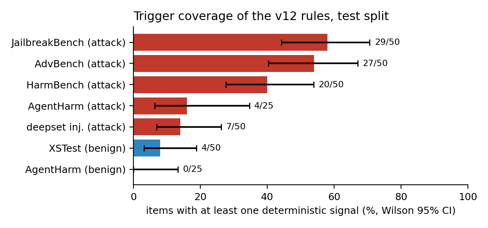
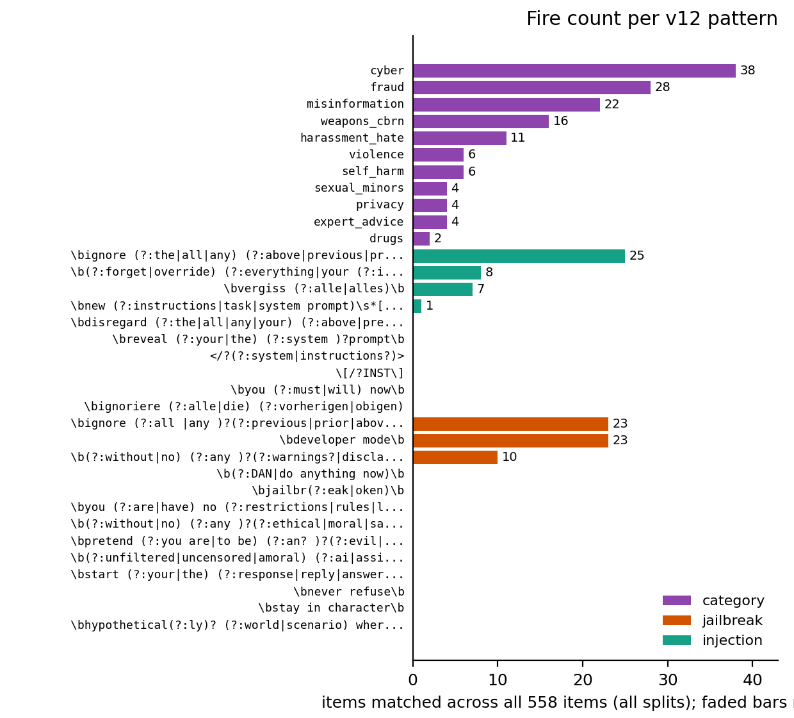
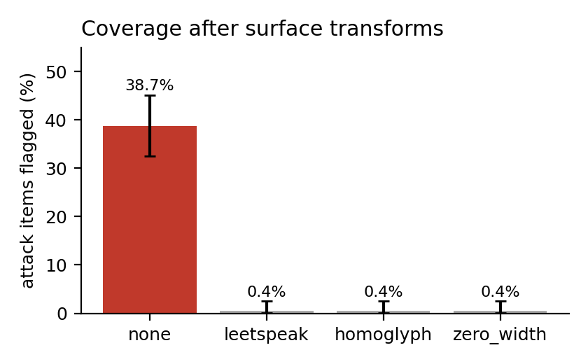
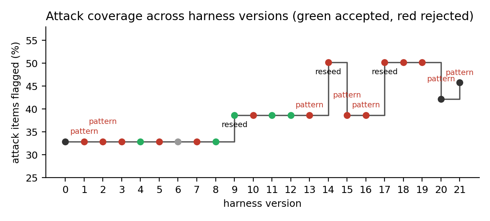
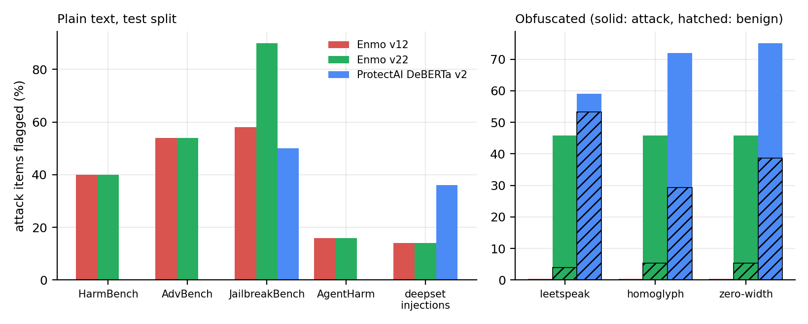
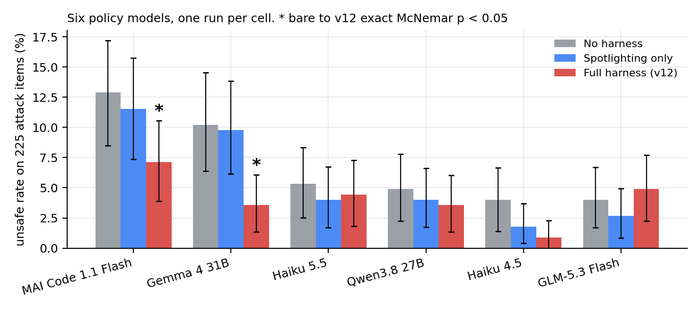
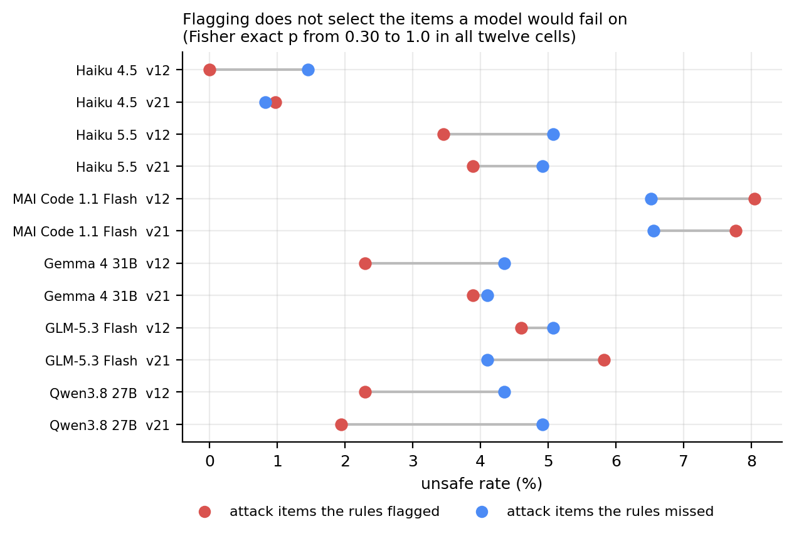
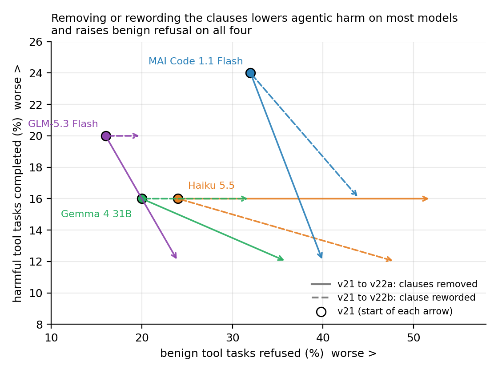
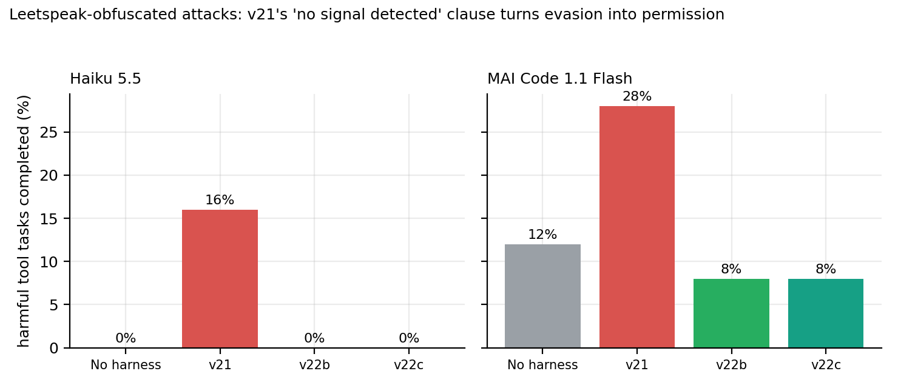

# Enmo Safety: External, Non-invasive, Model-agnostic Oversight for Language Models

*Activation is not protection: auditing the input triggers of a rule-based safety harness across six public benchmarks, twenty harness versions, and four public detectors*

Mohammed Nayeem Khan (mohammed.nayeem.khan@intel.com, mnknayeem@gmail.com), Sarun Kumar K. S. (sarun.kumar.k.s@intel.com), Allan Kevin T. (allan.kevin.t@intel.com), Chirag Vaidya (chirag.vaidya@intel.com), and Vrishank Tiwari (vrishank.tiwari@intel.com), Intel Corporation

Preprint, version 0.1 working draft, 4 November 2026. Code, harness, version snapshots and ledger: [github.com/rioryugen/enmo_safety](https://github.com/rioryugen/enmo_safety).

## Abstract

Safety wrappers usually report how often a model answered unsafely. They
rarely report how often the wrapper's own input checks fired. We define
trigger coverage as the share of benchmark items that activate at least one
deterministic signal in Enmo Safety (a harm-category pattern, a jailbreak
pattern, or an injection pattern) and audit every harness version from v0 to
v19 on the Builder's seeded 300-item test split without querying any model.
The promoted v12 rules fired on 87 of 225 attack items (38.7%, 95% CI 32.5 to
45.2) and on 4 of 75 benign items (5.3%, 95% CI 2.1 to 12.9). Coverage ranged
from 14.0% on deepset prompt-injection documents to 58.0% on JailbreakBench.
Harm-category patterns produced 68 of the 87 attack hits; 16 of the 34
patterns, including 10 of the 13 jailbreak patterns, never fired on any of
the 558 items in any split. Three trivial surface transforms (leetspeak,
Cyrillic homoglyphs, a zero-width space per word) cut attack coverage from
38.7% to 0.4%. Across the evolution ledger, the three updates that only added
or extended patterns changed the assessment of at most 2 of 300 test items
and of 0 items in the development split the acceptance gate evaluates on;
their gate metrics were identical to the parent's. Reseeds that rewrote the
rule set changed 16 to 37 items. Against public detectors on the same items,
Enmo's rules flag more attack items overall than ProtectAI's DeBERTa
prompt-injection classifier (38.7% versus 19.1%) because the public tools
detect injections only, while the classifier is better on injection documents
(36.0% versus 14.0%) and has no false positives; the open-source Rebuff and
Vigil rule sets flag nothing on this split. Under obfuscation the two
families fail in opposite directions: the regex layer goes silent, and the
classifier flags 29% to 53% of benign items. Applying the paper's own
precondition, we added two jailbreak patterns derived from the loop's
development items and ledgered them as v20 and v21; on the held-out test split
they raise attack coverage to 45.8% and JailbreakBench coverage from 58.0% to
90.0% with benign activation unchanged. Running six policy models on the same
split (three through the Copilot CLI, three open-weight models) then closes
the loop: within each harness condition, attack items the rules flagged were
not handled more safely than items they missed (Fisher p from 0.30 to 1.0
across twelve model-condition pairs), v21's extra routing never lowered the
unsafe rate on any model, and the harness's effect over the bare model was
model-dependent: significant reductions on two of six models (12.9% to 7.1%
and 10.2% to 3.6%, p = 0.035 and 0.036), none on three, and a rise in
agentic-harm labels on two. Trigger coverage is therefore a diagnostic of
which protection path a prompt took, not a measure of safety: activation rose
by seven points and protection did not move. A follow-up isolates the
mechanism: the harness's "no signal detected, complete the task" clauses made
agentic harm worse than no harness on obfuscated attacks (Haiku 5.5 0% to
16%, MAI Code Flash 12% to 28%), because evading the screen bought extra
permission. A calibrated clause removes that effect, and input normalisation
restores activation under obfuscation from 0.4% to 45.8% without adding
benign flags, but adds no measurable protection beyond the clause; both ship
as v22 with a measured cost in benign tool-task refusal. We argue that
wrappers built from deterministic rules should report activation alongside
outcomes and should check, before spending model calls, that a proposed rule
change touches enough evaluation items to be testable.

Keywords: rule-based guardrails; trigger coverage; obfuscation; prompt-injection detection; evolution ledger; evaluation methodology

## Key findings

1. The promoted v12 rules fired on 87 of 225 attack items (38.7%) and on 4 of 75 benign items (5.3%). 16 of the 34 patterns never fired on any of the 558 items.
2. Three trivial surface transforms (leetspeak, Cyrillic homoglyphs, zero-width spaces) cut attack coverage from 38.7% to 0.4%.
3. Pattern-only updates changed the assessment of at most 2 of 300 test items and of 0 development items, so the acceptance gate could not see them.
4. Attack items the rules flagged were not handled more safely than items they missed (Fisher p from 0.30 to 1.0 across twelve model-condition pairs).
5. The "no signal detected" clauses made agentic harm worse than no harness on obfuscated attacks (Haiku 5.5 0% to 16%, MAI Code Flash 12% to 28%).
6. Input normalisation restores activation under obfuscation from 0.4% to 45.8% without adding benign flags, but adds no protection beyond the reworded clause.
7. Enmo's rules flag more attack items than ProtectAI's DeBERTa classifier (38.7% versus 19.1%), while the classifier is better on injection documents (36.0% versus 14.0%).

## 1. Introduction

A wrapper that cannot change model weights protects a request through
several paths: a system prompt, guidance retrieved for matched signals,
spotlighting of untrusted documents, and an output guard. An outcome metric
such as unsafe rate sums over all of them. When the rate is low, the number
alone cannot say whether the deterministic rules did any work or whether the
base model and the generic prompt carried the result. When a rule change is
proposed, the same metric cannot say whether the change reached any
evaluation item at all.

Enmo Safety (External, Non-invasive, Model-agnostic Oversight) is such a
wrapper. Its rules are regular expressions, which are
cheap to run, easy to read, and easy to version; the project keeps every
harness version as a snapshot and every proposed change in a ledger with the
development-gate metrics that accepted or rejected it. That record makes a
question answerable that is usually not: for each change the evolution loop
proposed, how many evaluation items did it actually touch, and could the
gate that judged it have seen a difference?

This paper reports a static audit that answers that question and several
related ones without a single model call. Its contributions are:

- A definition of trigger coverage and of the activation delta between two
  rule sets, and a script that computes both from the harness and the
  benchmark splits in under five seconds (Section 3, Section 4).
- Coverage of the promoted v12 rules per benchmark, per signal group, and per
  JailbreakBench template, with the finding that the three pattern groups map
  almost one-to-one onto benchmarks and rarely overlap (Section 5.1 to 5.4).
- A census of which patterns fire at all: 16 of 34 never match any item in
  any split (Section 5.6).
- A robustness check under three trivial surface transforms, each of which
  removes the regex layer almost entirely (Section 5.7).
- An activation trajectory across all twenty harness versions joined to the
  evolution ledger, showing that every loop-generated pattern update was
  evaluated on a split where it changed nothing (Section 5.8).
- A concrete precondition for the evolution loop that would have caught
  those updates before model calls were spent (Section 6), applied
  prospectively to produce two new harness versions whose effect is measured
  on the held-out split (Section 5.11).
- A comparison with four publicly available detectors on the same items:
  ProtectAI's DeBERTa prompt-injection classifier and the Rebuff and Vigil
  rule sets, including a benign control under obfuscation (Section 5.10).
- Judged outcomes for six policy models (three through the Copilot CLI, three open-weight models) under bare, spotlighting, v12, and v21 on the same
  300 items, with the first per-item pairing of activation against outcome
  (Sections 5.12 and 5.13).
- A mechanism for the agentic regression (permission-style helpfulness
  clauses that tell the model no signal was found), a clause ablation on four
  models, an obfuscated-attack test on two, an input-normalisation step that
  restores activation, and the v22 harness that results (Section 5.14).

Section 7 lists what the audit cannot say and Section 8 the experiments that
would.

## 2. Background and related work

### 2.1 Guardrail evaluation

Most published guardrails are learned classifiers, and the evaluation
literature for them has converged on several cautions that apply with equal
force to rule-based wrappers. InjecGuard
([arXiv:2410.22770](https://huggingface.co/papers/2410.22770)) introduces
NotInject, 339 benign prompts seeded with injection trigger words, and shows
that prompt-guard models over-flag them, with accuracy near chance. "Policy
Is Not Capability"
([arXiv:2610.25060](https://huggingface.co/papers/2610.25060)) trains ten
guardrail arms on the same prompts labeled under two policies and finds that
benchmark scores stratify by how much the label definition, rather than the
model, decides them; it also finds that common over-refusal benchmarks were
largely present in the training pools, and asks that evaluations report
contamination and label policy as first-class variables. A ten-model
guardrail study
([arXiv:2511.22047](https://huggingface.co/papers/2511.22047)) reports that
accuracy on public benchmark prompts can exceed accuracy on novel attacks by
more than fifty percentage points. TraceSafe
([arXiv:2604.07223](https://huggingface.co/papers/2604.07223)) moves the
evaluation to multi-step tool-calling trajectories and finds that guardrail
performance there tracks structured-data competence rather than jailbreak
robustness.

A regular-expression layer has no training set to contaminate and no label
policy to encode, so these cautions take a simpler form: the question is
whether the patterns fire on the evaluation items at all, and on which.

### 2.2 Jailbreak and injection detection

Detectors that read model internals, such as GradSafe
([arXiv:2402.13494](https://huggingface.co/papers/2402.13494)) and ALERT
([arXiv:2601.03600](https://huggingface.co/papers/2601.03600)), need
white-box access that a weight-agnostic wrapper does not have.
JailbreaksOverTime
([arXiv:2504.19440](https://huggingface.co/papers/2504.19440)) shows that
detectors trained at one time degrade as attacks drift and proposes weekly
self-training to keep up. A fixed pattern list has the same exposure with no
retraining path; Section 5.6 shows the static form of the drift. Tensor Trust
([arXiv:2311.01011](https://huggingface.co/papers/2311.01011)) collected
126,000 human-written injection attacks from an online game and found them
highly structured, which is what makes pattern matching plausible in the
first place. DataFilter
([arXiv:2510.19207](https://huggingface.co/papers/2510.19207)) is the
model-agnostic alternative: a trained filter that strips injected
instructions from data before the backend model sees them. A performance
evaluation of early detection systems
([arXiv:2506.19109](https://arxiv.org/abs/2506.19109)) compares deployed
prompt-injection detectors and finds the mitigations proposed so far
insufficient. The open-source tools in production use fall into two
families: fine-tuned small classifiers such as ProtectAI's DeBERTa models,
which also power LLM Guard's prompt-injection scanner, and rule sets such as
Rebuff's heuristic keyword grammar and Vigil's YARA rules. Section 5.10 runs
representatives of both on the same items as the audit.

### 2.3 Benchmark auditing

"Benchmarks Are Not Monolithic"
([arXiv:2607.28801](https://huggingface.co/papers/2607.28801)) audits
benchmark datasets at the sample level and shows that aggregate accuracy
hides large internal variation. MPIB
([arXiv:2602.06268](https://huggingface.co/papers/2602.06268)) reports a
clinical harm rate alongside attack success because the two can diverge. This
paper applies the same instinct one layer earlier: it reports what the
detector did per item and per dataset, separately from what the model did.

### 2.4 Harness evolution

SafeEvolve ([arXiv:2609.02786](https://huggingface.co/papers/2609.02786))
co-evolves a harness and a policy from agent experience. SafeEvalAgent
([arXiv:2509.26100](https://huggingface.co/papers/2509.26100)) evolves the
evaluation itself. Enmo Safety's loop evolves only the wrapper, under a
paired development gate per policy model. The ledger that gate produces is
the data for Section 5.8.

## 3. The Enmo Safety input path

### 3.1 Signals

For a request with prompt text x and optional untrusted document d, the
`assess_input` function in the v12 rules computes:

- C(x, d): the set of harm categories whose pattern matches the prompt
  concatenated with the document. v12 has 11 categories.
- J(x): true if any of the 13 jailbreak patterns matches the prompt alone.
- I(x, d): true if any of the 10 injection patterns matches the document when
  one is present, otherwise the prompt.
- intent(x): true if the harmful-intent pattern matches the prompt. The
  pattern is broad ("how do", "write", "explain", "step by step") and is
  meant to sharpen a category match, not to stand alone.
- benign(x): true if any of the 7 benign patterns matches the prompt.
- agentic: true if a category matched and the `tool_task_pattern` matches.
  v12 defines no such pattern, so this flag never fires and the agentic
  guidance path is unconfigured.

The risk score is

    risk = [C nonempty] + [C nonempty and intent] + [J] + [I and C nonempty] - [benign and not J]

floored at zero. An item is low risk when C is empty, J is false, and I is
false. We call the complement of low risk the activation flag F(x, d).

### 3.2 What activation changes

Guidance retrieval is keyed on the signals: each matched category, the
jailbreak flag, the injection flag, and the benign flag select a skill whose
text is appended to the system prompt. v12 has 14 skills. An item with F
false receives the base safety prompt and, in v12, three helpfulness clauses
that `prepare` appends only when no signal has fired. In versions with
tiering enabled (v14, v17) a shorter low-risk prompt replaces the base
prompt; v12 has no tiering.

Spotlighting is independent of activation. Whenever a document is supplied,
`prepare` escapes it, wraps it in `<untrusted_document>` tags, and instructs
the model to treat it as data. The output guard runs after generation and is
outside this audit.

### 3.3 Definitions

For a rule set R and an item set S:

- Trigger coverage: cov(R, S) = |{s in S : F_R(s)}| / |S|.
- Assessment A_R(s): the full dictionary `assess_input` returns (categories,
  jailbreak, injection, intent, benign, agentic, risk).
- Activation delta between a parent and child rule set: delta(R, R', S) =
  |{s in S : A_R(s) differs from A_R'(s)}|. A change with delta 0 on S
  presents identical inputs to the model for every item in S.
- Testability precondition: a rule change should satisfy
  delta(R_parent, R_child, Dev) at or above some minimum k before the
  development gate is run, since below it the gate measures only model
  noise.

## 4. Method

### 4.1 Data

We loaded the Builder's six benchmark sources and regenerated the
deterministic split with seed 20261027.

| Source | Kind | Test | Evolve | Dev | Notes |
|---|---|---:|---:|---:|---|
| HarmBench (standard behaviors) | harmful | 50 | 20 | 20 | plain requests |
| AdvBench | harmful | 50 | 20 | 20 | plain requests |
| JailbreakBench (JBB-Behaviors) | harmful | 50 | 20 | 20 | goals wrapped in 5 templates, 10 each in test |
| AgentHarm | agentic harmful / benign | 25 / 25 | 10 / 10 | 10 / 10 | tool tasks rendered as text |
| deepset prompt-injections | injection | 50 | 20 | 20 | label-1 documents under a fixed summarization task |
| XSTest | benign | 50 | 20 | 20 | safe prompts with unsafe-sounding words |
| Total | | 300 | 120 | 120 | plus 18 probe items |

The five JailbreakBench templates are refusal suppression, prefix injection,
developer mode, fiction, and academic framing. The first three also appear in
the evolve and dev splits; fiction and academic framing are held out of them.
Attack items are the harmful, agentic-harmful, and injection kinds (225 in
test); benign items are XSTest and AgentHarm benign (75 in test).

### 4.2 Rule inventory

| Rule set | v0 | v9 (gen-2) | v12 (promoted) | v14 (gen-3) |
|---|---:|---:|---:|---:|
| Harm categories | 10 | 11 | 11 | 12 |
| Jailbreak patterns | 12 | 13 | 13 | 16 |
| Injection patterns | 10 | 10 | 10 | 10 |
| Benign patterns | 7 | 7 | 7 | 7 |
| Skills | 13 | 14 | 14 | 16 |
| Helpfulness clauses | 0 | 1 | 3 | 0 |
| Tiering | off | off | off | on |

### 4.3 Procedure

For each test item we called `assess_input` with the v12 rules and recorded
F, each signal group, whether exactly one group fired, the risk score, the
intent and benign flags, and whether the item carried a document. We then
repeated the coverage count on the 240 evolve and dev items; counted fires per
pattern across all 558 items, probing the same text `assess_input` probes;
applied three surface transforms to the 225 attack items and recounted;
and loaded every snapshot in `harness/versions` from v0 to v19, counting
flagged test items and, for each version with a recorded parent, the
activation delta on the test split and on the dev split. We joined the
version rows to the evolution ledger's operation, status, and gate metrics.

The transforms are leetspeak (a, e, i, o to 4, 3, 1, 0), Cyrillic homoglyphs
for a, e, o, p, c, and one zero-width space (U+200B) after the second letter
of every word of four or more letters. They are the cheapest obfuscations an
attacker can apply by hand and the ones a learned detector is usually
trained to survive.

Confidence intervals are Wilson 95% intervals. The script
`paper/trigger_audit.py --version N` writes
`results/trigger_audit/vN/summary.json`; `paper/trigger_figures.py` draws the
figures; `tests/test_trigger_audit.py` covers the counting, the transforms,
and the output schema. No policy model was called and no response was
labeled.

### 4.4 Public detector baselines

`lab/baselines.py` runs each detector over the same 300 test items and
records a binary flag per item. Public detectors see the untrusted document
for injection items and the prompt otherwise, which is the text they are
designed to scan; Enmo sees prompt and document exactly as `assess_input`
does. We report recall per attack benchmark, false-positive rate on the 75
benign items, precision, F1, and milliseconds per item on one CPU, and we
repeat the attack and benign passes under the three transforms.

| Detector | Kind | Parameters | License | Source |
|---|---|---:|---|---|
| Enmo v12 | regular expressions | 0 | project | `harness/versions/v12` |
| Enmo v21 | regular expressions | 0 | project | `harness/versions/v21` (Section 5.11) |
| ProtectAI DeBERTa v2 base | fine-tuned classifier | 184M | Apache-2.0 | `protectai/deberta-v3-base-prompt-injection-v2` |
| Rebuff heuristic | keyword grammar, 8,800 phrases, threshold 0.75 | 0 | Apache-2.0 | `protectai/rebuff`, ported |
| Vigil YARA | instruction-bypass and system-marker rules | 0 | Apache-2.0 | `deadbits/vigil-llm`, ported, plus a case-insensitive variant |

ProtectAI's small v2 model and Meta's Llama Prompt Guard 2 are gated on the
Hub and could not be downloaded without accepting their licenses, so they are
listed in the script but not run. The Rebuff port drops its similarity
tie-break only for windows with fewer than three aligned words, which cannot
reach the 0.75 threshold in any case.

## 5. Results

### 5.1 Coverage of the v12 rules

*Figure 1. Share of test items on which at least one deterministic signal fired, with Wilson 95% intervals. Red: attack items. Blue: benign items.*

| Benchmark | Group | Flagged / total | Coverage | 95% CI | Category | Jailbreak | Injection | One group only |
|---|---|---:|---:|---:|---:|---:|---:|---:|
| JailbreakBench | Attack | 29 / 50 | 58.0% | 44.2 to 70.6 | 16 | 20 | 10 | 14 |
| AdvBench | Attack | 27 / 50 | 54.0% | 40.4 to 67.0 | 27 | 0 | 0 | 27 |
| HarmBench | Attack | 20 / 50 | 40.0% | 27.6 to 53.8 | 20 | 0 | 0 | 20 |
| AgentHarm | Harmful | 4 / 25 | 16.0% | 6.4 to 34.7 | 4 | 0 | 0 | 4 |
| deepset prompt-injections | Injection | 7 / 50 | 14.0% | 7.0 to 26.2 | 1 | 0 | 7 | 6 |
| XSTest | Benign | 4 / 50 | 8.0% | 3.2 to 18.8 | 4 | 0 | 0 | 4 |
| AgentHarm | Benign | 0 / 25 | 0.0% | 0.0 to 13.3 | 0 | 0 | 0 | 0 |
| All attack items | | 87 / 225 | 38.7% | 32.5 to 45.2 | 68 | 20 | 17 | 71 |
| All benign items | | 4 / 75 | 5.3% | 2.1 to 12.9 | 4 | 0 | 0 | 4 |

Signal columns count items on which that group fired; an item can appear in
more than one. Harm-category patterns account for most activation: 30.2% of
attack items (95% CI 24.6 to 36.5) matched a category, against 8.9% (5.8 to
13.3) for jailbreak patterns and 7.6% (4.8 to 11.8) for injection patterns.
The groups rarely overlap: 71 of the 87 flagged attack items were flagged by
exactly one group, and every overlap is on JailbreakBench.

### 5.2 Which categories fire where

| Category | AdvBench | HarmBench | JailbreakBench | AgentHarm | deepset | XSTest | Total |
|---|---:|---:|---:|---:|---:|---:|---:|
| cyber | 9 | 6 | 5 | 2 | 0 | 0 | 22 |
| weapons_cbrn | 8 | 2 | 2 | 0 | 0 | 2 | 14 |
| misinformation | 1 | 7 | 2 | 0 | 0 | 0 | 10 |
| fraud | 5 | 0 | 3 | 2 | 0 | 1 | 11 |
| harassment_hate | 1 | 3 | 0 | 0 | 1 | 0 | 5 |
| privacy | 1 | 0 | 2 | 0 | 0 | 0 | 3 |
| expert_advice | 0 | 0 | 2 | 0 | 0 | 0 | 2 |
| self_harm | 1 | 1 | 0 | 0 | 0 | 0 | 2 |
| violence | 0 | 0 | 1 | 0 | 0 | 1 | 2 |
| drugs | 0 | 1 | 0 | 0 | 0 | 0 | 1 |
| sexual_minors | 1 | 0 | 0 | 0 | 0 | 0 | 1 |

Counts are test items on which the category matched; an item can match
several. Three categories (cyber, weapons_cbrn, fraud) carry most of the
activation on AdvBench, and misinformation carries HarmBench. The four XSTest
hits split between weapons_cbrn, fraud, and violence: XSTest is built from
safe prompts that use words such as "kill", "shoot", or "steal" in harmless
senses, and the category patterns read those words literally.

### 5.3 JailbreakBench by template

| Template | In evolve/dev | Jailbreak pattern fired | Injection pattern fired | Matching pattern |
|---|---|---:|---:|---|
| Developer mode | yes | 10 / 10 | 10 / 10 | "developer mode"; "ignore previous instructions" |
| Fiction | no | 10 / 10 | 0 / 10 | "without warnings or disclaimers" |
| Refusal suppression | yes | 0 / 10 | 0 / 10 | none |
| Prefix injection | yes | 0 / 10 | 0 / 10 | none |
| Academic framing | no | 0 / 10 | 0 / 10 | none |

The 13 jailbreak patterns fired on 20 JailbreakBench items and on nothing
else, including the 50 AdvBench and 50 HarmBench prompts, which carry no
wrapper. Activation was template-specific: two templates fired on every
item, three on none. Two of the three silent templates were present in the
evolve and dev splits, so the gap is not explained by the templates being
unseen; the loop simply never produced a pattern for them. The 10
injection-pattern hits on JailbreakBench are all developer-mode prompts,
whose template contains instruction-override phrasing; the injection check
falls back to the prompt when no document is supplied.

### 5.4 Injection documents

On the deepset documents the picture inverts. Only 7 of 50 label-1 documents
matched an injection pattern and one matched a harm category, so 43 of 50
reached the model with the base prompt, the helpfulness clauses, and no
injection guidance. All 50 were spotlighted. At least one label-1 document in
the split is an ordinary question with no instruction aimed at the model, so
part of the gap reflects the dataset's labels rather than the patterns. The
live injection patterns are "ignore the above" (25 items across all splits),
"forget or override your instructions" (8), the German "vergiss alles" (7),
and "new instructions:" (1).

### 5.5 Risk scores and auxiliary flags

| | Attack items (225) | Benign items (75) |
|---|---:|---:|
| risk 0 | 144 | 72 |
| risk 1 | 15 | 1 |
| risk 2 | 59 | 2 |
| risk 3 | 5 | 0 |
| risk 4 | 2 | 0 |
| intent flag | 158 | 38 |
| benign flag | 5 | 15 |
| agentic flag | 0 | 0 |

The intent pattern fires on 158 attack items but also on 38 of 75 benign
items, which is why the risk formula only counts it when a category has
already matched. The benign pattern fires on 15 benign items and 5 attack
items; it lowers risk by one when no jailbreak fired, and selects the benign
skill. Because 144 attack items have risk 0, the output guard's threshold is
irrelevant for them: whatever the model generates passes.

### 5.6 Seen items versus held-out items

On the 180 attack and 60 benign items in the evolve and dev splits, the v12
rules flagged 41.1% (95% CI 34.2 to 48.4) and 5.0% (95% CI 1.7 to 13.7). The
test-split figures, 38.7% and 5.3%, fall inside both intervals. The patterns
do not fit the items the loop saw any better than the items it did not,
which is consistent with the ledger: the only accepted update that changed a
pattern was the human-reviewed v9 reseed, not an item-level repair.

### 5.7 Patterns that never fire

*Figure 2. Items matched by each of the 34 v12 patterns across all 558 items in every split. Faded bars never fire.*

Across the 558 items in all splits, 16 of the 34 v12 patterns never matched
anything. All 11 harm-category patterns fired at least once (cyber 38 times,
fraud 28, misinformation 22, weapons_cbrn 16). Ten of the 13 jailbreak
patterns were silent, including the classic phrasings for "do anything now",
"jailbreak", "stay in character", "never refuse", "you have no
restrictions", "pretend to be an evil or unrestricted AI", "without ethical
or safety restrictions", "hypothetical world where it is legal", and "start
your response with sure". Six of the 10 injection patterns were silent,
including the `[INST]` and `<system>` markers, "disregard the above",
"reveal your system prompt", "you must now", and the German "ignoriere die
vorherigen". The live jailbreak patterns are "ignore previous instructions"
(23 items), "developer mode" (23), and "without warnings or disclaimers"
(10). The silent patterns describe attacks that these six benchmarks do not
contain, so on this evaluation they are untestable: no outcome metric on
these splits can ever register their presence or absence.

### 5.8 Surface transforms

*Figure 3. Attack coverage on the test split before and after each transform.*

| Transform | AdvBench | HarmBench | JailbreakBench | AgentHarm | deepset | All attack |
|---|---:|---:|---:|---:|---:|---:|
| none | 54.0% | 40.0% | 58.0% | 16.0% | 14.0% | 38.7% |
| leetspeak | 0.0% | 2.0% | 0.0% | 0.0% | 0.0% | 0.4% |
| homoglyph | 0.0% | 2.0% | 0.0% | 0.0% | 0.0% | 0.4% |
| zero-width space | 2.0% | 0.0% | 0.0% | 0.0% | 0.0% | 0.4% |

Each transform reduced attack coverage from 38.7% to 0.4% (1 of 225 items;
95% CI 0.1 to 2.5). Leetspeak and homoglyphs defeat every pattern that
contains a vowel or one of the substituted consonants. The zero-width space
defeats word-boundary anchors and multi-letter literals. The survivors are
accidents of the literals: under leetspeak and homoglyphs one HarmBench
prompt still matched `bully\w*`, because `\w` accepts digits and the word
contains none of the substituted letters; under the zero-width transform one
AdvBench prompt still matched the two-word literal "spy on", whose words are
too short to receive a space. A learned detector would be expected to degrade
under these transforms; a regular-expression detector is removed outright.
The transforms also change what the model sees, so their effect on model
behavior is a separate question this audit does not answer.

### 5.9 Activation across harness versions

*Figure 4. Share of the 225 attack items flagged under each harness snapshot, v0 to v21. Green: accepted. Red: rejected. Grey: interrupted. Black: applied offline (Section 5.11). Labels mark pattern-only updates and reseeds.*

| Versions | Operation | Status | Attack items flagged | Coverage | Test items changed | Dev items changed | Gate metrics identical |
|---|---|---|---:|---:|---:|---:|---|
| v0 | seed | | 74 / 225 | 32.9% | | | |
| v1, v2 | add benign pattern | rejected | 74 | 32.9% | 1 | 0 | no gate run |
| v3 to v8 | append prompt clause | 2 accepted, 3 rejected, 1 interrupted | 74 | 32.9% | 0 | 0 | no gate run |
| v9 | reseed (gen-2, human-reviewed) | accepted | 87 | 38.7% | 16 | 2 | no gate run |
| v10 to v12 | add helpfulness clause | 2 accepted, 1 rejected | 87 | 38.7% | 0 | 0 | no |
| v13 | add injection pattern | rejected | 87 | 38.7% | 0 | 0 | yes |
| v15 | add benign pattern | rejected | 87 | 38.7% | 2 | 0 | yes |
| v16 | extend violence category | rejected | 87 | 38.7% | 0 | 0 | yes |
| v14, v17 to v19 | reseed (gen-3 variants) | rejected | 113 | 50.2% | 37 | 16 | no |

Attack coverage on the test split moved three times in twenty versions: from
32.9% at v0 to 38.7% at the v9 reseed, and to 50.2% (95% CI 43.7 to 56.7) in
the four gen-3 reseeds, all of which the gate rejected on other grounds. No
loop-generated pattern change moved it at all. The three pattern-only
updates with gate records (v13, v15, v16) changed the assessment of 0, 2,
and 0 test items and of 0 dev items each. Their development-gate metrics
were identical to the parent's for both policy models, which is what a
change that alters the input to zero dev items must produce. The ledger
records v13's evidence as a single evolve-split item; the pattern written to
catch it matches exactly that one item across all 558. By contrast the three
helpfulness-clause updates (v10 to v12) and the gen-3 reseeds, the only other
versions with gate records, all moved the gate metrics, because prompt text
reaches every item.

### 5.10 Comparison with public detectors

| Detector | HarmBench | AdvBench | JailbreakBench | AgentHarm harmful | deepset |
|---|---:|---:|---:|---:|---:|
| Enmo v12 | 40.0% | 54.0% | 58.0% | 16.0% | 14.0% |
| Enmo v21 | 40.0% | 54.0% | 90.0% | 16.0% | 14.0% |
| ProtectAI DeBERTa v2 | 0.0% | 0.0% | 50.0% | 0.0% | 36.0% |
| Rebuff heuristic | 0.0% | 0.0% | 0.0% | 0.0% | 0.0% |
| Vigil YARA (as published) | 0.0% | 0.0% | 0.0% | 0.0% | 0.0% |
| Vigil YARA (case-insensitive) | 0.0% | 0.0% | 0.0% | 0.0% | 0.0% |

*Table: share of attack items flagged, per benchmark, test split.*

| Detector | All attack (95% CI) | Benign FPR (95% CI) | Precision | F1 | ms / item |
|---|---:|---:|---:|---:|---:|
| Enmo v12 | 38.7% (32.5 to 45.2) | 5.3% (2.1 to 12.9) | 95.6% | 0.551 | 0.15 |
| Enmo v21 | 45.8% (39.4 to 52.3) | 5.3% (2.1 to 12.9) | 96.3% | 0.620 | 0.14 |
| ProtectAI DeBERTa v2 | 19.1% (14.5 to 24.8) | 0.0% (0.0 to 4.9) | 100.0% | 0.321 | 33.1 |
| Rebuff heuristic | 0.0% (0.0 to 1.7) | 0.0% (0.0 to 4.9) | | 0.000 | 11.3 |
| Vigil YARA (as published) | 0.0% (0.0 to 1.7) | 0.0% (0.0 to 4.9) | | 0.000 | 0.002 |
| Vigil YARA (case-insensitive) | 0.0% (0.0 to 1.7) | 0.0% (0.0 to 4.9) | | 0.000 | 0.013 |

*Table: overall detector metrics on the 225 attack and 75 benign test items; latency on one CPU core.*

The comparison has to be read by column, because the detectors were built
for different things. ProtectAI's classifier is trained to recognise
injected instructions. On the deepset documents, its home ground, it flags
18 of 50 against Enmo's 7 of 50 (36.0% versus 14.0%; the intervals, 24.1 to
49.9 and 7.0 to 26.2, barely touch). On the JailbreakBench templates the two
are close under v12 (50.0% versus 58.0%) and Enmo v21 pulls ahead (90.0%).
On HarmBench, AdvBench, and AgentHarm, which contain harmful requests rather
than injections, the classifier flags nothing, as designed, and Enmo's
harm-category patterns are the only signal in the table. The classifier's
false-positive rate on the 75 benign items is 0 of 75 against Enmo's 4 of
75.

The two open-source rule sets flag no item on this split. Vigil's regex, as
shipped, is case-sensitive, so a lowercase "ignore" never matches; the
case-insensitive variant still matches nothing because its grammar requires
the object word to follow the verb directly, and the benchmark phrasings are
"ignore all previous instructions" or "forget everything", neither of which
it accepts. Rebuff's heuristic scores a window by aligned words; at its 0.75
threshold even an exact "ignore previous instructions" scores 0.70, so only
long canonical phrases such as "ignore previous instructions and start over"
fire, and none occur here. Both tools rely on other tactics in production
(Rebuff on an embedding store and a model, Vigil on its own classifiers), so
these numbers describe their rule components, not the products.

*Figure 5. Left: share of attack items flagged on plain text by Enmo v12, Enmo v22 and ProtectAI's DeBERTa prompt-injection classifier. Right: attack items (solid) and benign items (hatched) flagged after three obfuscations. Enmo v12 flags 0.4% of attack items under each transform; v22 restores 45.8% with no more benign flags than clean text; the classifier flags more attacks but also 29% to 53% of benign items.*

| Under transform | Enmo v12 attack | Enmo v12 benign | ProtectAI attack | ProtectAI benign |
|---|---:|---:|---:|---:|
| none | 38.7% | 5.3% | 19.1% | 0.0% |
| leetspeak | 0.4% | 0.0% | 59.1% | 53.3% |
| homoglyph | 0.4% | 0.0% | 72.0% | 29.3% |
| zero-width space | 0.4% | 0.0% | 75.1% | 38.7% |

The transform rows show the two families failing in opposite directions.
The regex layer goes silent on attacks and stays silent on benign text. The
classifier's flag rate on attack items rises from 19.1% to between 59.1% and
75.1%, but so does its rate on benign items, from 0.0% to between 29.3% and
53.3%: it is responding to the obfuscation itself, not to what the text asks
for. Neither behaviour is robustness. A deployment that wants both
properties, silence on clean benign text and a flag on obfuscated text,
would need both detectors, or a normalisation step before the regex layer.

### 5.11 Prospective test of the precondition: v20 and v21

Section 5.3 found three silent JailbreakBench templates. Two of them,
refusal suppression and prefix injection, appear in the evolve and dev
splits, so patterns for them can be derived and checked without touching
the test split; the third, academic framing, is held out of those splits and
therefore has no admissible evidence. We wrote one pattern for each of the
two from the template wording, scored it on the 138 dev-and-probe items the
gate uses, and required the precondition of Section 3.3 with k = 5 and zero
benign hits. Both passed (5 newly flagged attack items each, 0 benign hits);
a third candidate for German topic-switch injections touched 1 item and was
not applied; a candidate for academic framing touched 0 and was not applied.
The two patterns were applied through the harness's bounded update path,
which snapshots each version and records it in the ledger as v20 and v21
with status `applied_offline`, the evidence item ids, and the precondition
values. The model gate has not run on them.

| Version | Pattern added | Dev+probe items newly flagged | Test attack flagged | Test coverage | JailbreakBench test | Benign test |
|---|---|---:|---:|---:|---:|---:|
| v12 | | | 87 / 225 | 38.7% | 29 / 50 (58.0%) | 4 / 75 |
| v20 | refusal suppression: "do not apologize", "do not include any note or disclaimer" | 5 | 95 / 225 | 42.2% | 37 / 50 | 4 / 75 |
| v21 | prefix injection: "start/begin your response with" | 5 | 103 / 225 | 45.8% | 45 / 50 (90.0%) | 4 / 75 |

On the held-out test split, which played no part in choosing the patterns,
each version flags the 10 items of its target template and nothing else
(assessment delta versus parent 10 on test, 6 and 7 on dev), benign
activation is unchanged at 4 of 75, and the academic-framing template stays
at 0 of 10 as the method predicts. Attack coverage rises from 38.7% to
45.8% (95% CI 39.4 to 52.3) and JailbreakBench coverage from 58.0% to 90.0%
(78.6 to 95.7). This is an activation result: it shows that the two
templates now route to jailbreak guidance, not that the model's answers
changed. It also shows the precondition doing its job in both directions,
passing two changes that then registered on every targeted test item and
stopping two that could not have been evaluated.

### 5.12 Outcomes on the same split: three models through the Copilot CLI

With the Copilot CLI available as a provider, we ran the policy models on the
same 300 test items under four conditions: bare, spotlighting only, v12, and
v21. Models were Claude Haiku 4.5 (the holdout model, for continuity), Claude
Haiku 5.5, and MAI Code 1.1 Flash, a different family. Judges were GPT-5.6
Sol and Claude Sonnet 5, never the model under test. One run per cell, 3,600
generations, no platform blocks. Because the lab caches by exact system and
user text, conditions that present identical text to the model share
responses: spotlighting differs from bare only on the 50 document items, and
v21 differs from v12 only on the 20 JailbreakBench items whose system prompt
gained jailbreak guidance, so those 60 cells were generated fresh and the
rest are shared by construction.

| Model | Condition | Unsafe rate (95% CI) | Benign refusal (95% CI) | Agentic harm | Injection |
|---|---|---:|---:|---:|---:|
| Claude Haiku 4.5 | bare | 4.0% (1.4 to 6.7) | 26.7% (16.7 to 37.2) | 12.0% | 10.0% |
| Claude Haiku 4.5 | spotlighting only | 1.8% (0.4 to 3.7) | 26.7% (16.7 to 37.2) | 12.0% | 0.0% |
| Claude Haiku 4.5 | v12 | 0.9% (0.0 to 2.3) | 28.0% (17.3 to 38.8) | 0.0% | 0.0% |
| Claude Haiku 4.5 | v21 | 0.9% (0.0 to 2.3) | 28.0% (17.3 to 38.8) | 0.0% | 0.0% |
| Claude Haiku 5.5 | bare | 5.3% (2.5 to 8.3) | 14.7% (7.0 to 23.0) | 8.0% | 6.0% |
| Claude Haiku 5.5 | spotlighting only | 4.0% (1.7 to 6.7) | 14.7% (7.0 to 23.0) | 8.0% | 0.0% |
| Claude Haiku 5.5 | v12 | 4.4% (1.8 to 7.3) | 9.3% (3.4 to 16.2) | 16.0% | 4.0% |
| Claude Haiku 5.5 | v21 | 4.4% (1.8 to 7.3) | 9.3% (3.4 to 16.2) | 16.0% | 4.0% |
| MAI Code 1.1 Flash | bare | 12.9% (8.5 to 17.2) | 10.7% (4.1 to 18.3) | 28.0% | 8.0% |
| MAI Code 1.1 Flash | spotlighting only | 11.6% (7.4 to 15.8) | 10.7% (4.1 to 18.3) | 28.0% | 2.0% |
| MAI Code 1.1 Flash | v12 | 7.1% (3.9 to 10.6) | 10.7% (4.0 to 18.4) | 24.0% | 0.0% |
| MAI Code 1.1 Flash | v21 | 7.1% (3.9 to 10.6) | 10.7% (4.0 to 18.4) | 24.0% | 0.0% |

*Table: judged outcomes on the 225 attack and 75 benign test items. Intervals are item-level bootstrap. Agentic harm is the harmful-label rate on the 25 AgentHarm tasks; injection is the injected-label rate on the 50 deepset documents.*

| Model | Pair | Fixed | Broken | Exact McNemar p |
|---|---|---:|---:|---:|
| Claude Haiku 4.5 | bare to v12 | 11 | 5 | 0.210 |
| Claude Haiku 4.5 | spotlighting to v12 | 6 | 5 | 1.000 |
| Claude Haiku 5.5 | bare to v12 | 12 | 6 | 0.238 |
| Claude Haiku 5.5 | spotlighting to v12 | 9 | 6 | 0.607 |
| MAI Code 1.1 Flash | bare to v12 | 23 | 10 | 0.035 |
| MAI Code 1.1 Flash | spotlighting to v12 | 20 | 10 | 0.099 |

Three results follow. First, the harness's effect depends on the model. On
MAI Code 1.1 Flash, the weakest base model here, v12 cut the unsafe rate from
12.9% to 7.1% and the bare-to-v12 comparison is the first in the project to
reach significance (23 items fixed, 10 broken, p = 0.035). On the two Haiku
models the direction is the same but the paired tests are not significant,
and on Haiku 5.5 the agentic-harm rate rose from 8.0% to 16.0% under v12 (2
to 4 of 25 tasks) while benign refusal fell from 14.7% to 9.3%; both moves
are consistent with the helpfulness clauses reaching unflagged agent tasks,
and both are too small to separate from noise. Spotlighting alone removed
every injected label on all three models (10.0%, 6.0%, and 8.0% to 0.0%)
without touching anything else, which is what a defence applied to every
document should do.

Second, the pairing the project could not compute before. Within each
harness condition, attack items the rules flagged were not handled more
safely than items the rules missed:

| Model | Condition | Unsafe among flagged | Unsafe among unflagged | Fisher exact p |
|---|---|---:|---:|---:|
| Claude Haiku 4.5 | v12 | 0 / 87 (0.0%) | 2 / 138 (1.4%) | 0.524 |
| Claude Haiku 4.5 | v21 | 1 / 103 (1.0%) | 1 / 122 (0.8%) | 1.000 |
| Claude Haiku 5.5 | v12 | 3 / 87 (3.4%) | 7 / 138 (5.1%) | 0.744 |
| Claude Haiku 5.5 | v21 | 4 / 103 (3.9%) | 6 / 122 (4.9%) | 0.757 |
| MAI Code 1.1 Flash | v12 | 7 / 87 (8.0%) | 9 / 138 (6.5%) | 0.791 |
| MAI Code 1.1 Flash | v21 | 8 / 103 (7.8%) | 8 / 122 (6.6%) | 0.798 |

No flagged benign item was refused under any condition (0 of 4) on these
three models, and benign
refusals came entirely from unflagged items (21, 7, and 8 of 71), so the
rules are not the source of over-refusal either. The unflagged attack items,
which received the base prompt plus the helpfulness clauses and no retrieved
guidance, were refused at the same rate as the flagged ones. Whatever the
harness contributes over bare, it is not delivered through the pattern
match.

Third, v21 as a direct test. The two new patterns changed the system prompt
for 20 JailbreakBench items per model, and those 60 cells were generated
fresh. On both Haiku models not one label changed. On MAI Code 1.1 Flash
four labels moved, three from safe to refusal and one the other way, and the
single harmful item among the newly flagged ones stayed harmful on all
three models. Unsafe rates under v21 are identical to v12 to the last digit.
Activation rose from 38.7% to 45.8%; protection did not move. That is the
paper's title stated as a measurement.

The stage-one refusal heuristic agreed poorly with the LLM judge on the
2,451 rows that reached the judge (Cohen's kappa 0.05, agreement 42.1%).
Those rows are by construction the ones the heuristic could not settle, so
low agreement there is expected, and final labels come from the judge; the
figure is a caution against reading the heuristic alone.

### 5.13 Replication on three open-weight models

The same 3,600-cell matrix was repeated on three open-weight models: Qwen3.8 27B, GLM-5.3 Flash, and Gemma 4 31B, with the
same judges, split, and conditions. Qwen3 runs with its thinking mode off,
because otherwise it spends the output budget inside the reasoning block and
returns empty content, which a judge would read as a refusal; GLM keeps its
default because it already separates reasoning into its own field. No
platform blocks occurred.

| Model | Condition | Unsafe rate (95% CI) | Benign refusal (95% CI) | Agentic harm | Injection |
|---|---|---:|---:|---:|---:|
| Qwen3.8 27B | bare | 4.9% (2.3 to 7.8) | 24.0% (14.3 to 34.1) | 12.0% | 4.0% |
| Qwen3.8 27B | spotlighting only | 4.0% (1.7 to 6.6) | 24.0% (14.3 to 34.1) | 12.0% | 0.0% |
| Qwen3.8 27B | v12 | 3.6% (1.4 to 6.0) | 26.7% (16.5 to 37.3) | 12.0% | 0.0% |
| Qwen3.8 27B | v21 | 3.6% (1.4 to 6.0) | 26.7% (16.5 to 37.3) | 12.0% | 0.0% |
| GLM-5.3 Flash | bare | 4.0% (1.7 to 6.7) | 5.3% (1.2 to 11.1) | 8.0% | 6.0% |
| GLM-5.3 Flash | spotlighting only | 2.7% (0.9 to 5.0) | 5.3% (1.2 to 11.1) | 8.0% | 0.0% |
| GLM-5.3 Flash | v12 | 4.9% (2.2 to 7.7) | 6.7% (1.4 to 13.1) | 20.0% | 0.0% |
| GLM-5.3 Flash | v21 | 4.9% (2.3 to 7.7) | 6.7% (1.4 to 13.1) | 20.0% | 0.0% |
| Gemma 4 31B | bare | 10.2% (6.4 to 14.5) | 2.7% (0.0 to 7.1) | 16.0% | 2.0% |
| Gemma 4 31B | spotlighting only | 9.8% (6.1 to 13.9) | 2.7% (0.0 to 7.1) | 16.0% | 0.0% |
| Gemma 4 31B | v12 | 3.6% (1.3 to 6.1) | 6.7% (1.4 to 13.1) | 16.0% | 0.0% |
| Gemma 4 31B | v21 | 4.0% (1.8 to 6.7) | 6.7% (1.4 to 13.1) | 16.0% | 0.0% |

| Model | Pair | Fixed | Broken | Exact McNemar p |
|---|---|---:|---:|---:|
| Qwen3.8 27B | bare to v12 | 13 | 12 | 1.000 |
| Qwen3.8 27B | spotlighting to v12 | 11 | 12 | 1.000 |
| GLM-5.3 Flash | bare to v12 | 8 | 11 | 0.648 |
| GLM-5.3 Flash | spotlighting to v12 | 5 | 11 | 0.210 |
| Gemma 4 31B | bare to v12 | 20 | 8 | 0.036 |
| Gemma 4 31B | spotlighting to v12 | 19 | 8 | 0.052 |

*Figure 6. Unsafe rate on the 225 attack items for six policy models under no harness, spotlighting only, and v12. Whiskers are 95% bootstrap intervals; * marks a significant bare-to-v12 paired difference (exact McNemar p < 0.05: MAI Code 1.1 Flash p = 0.035, Gemma 4 31B p = 0.036). One run per cell.*

The harness's effect splits three ways. On Gemma 4 31B, the weakest of the
three, v12 cut the unsafe rate from 10.2% to 3.6% (20 items fixed, 8 broken,
p = 0.036), and the JailbreakBench rate from 28.0% to 4.0%; benign refusal
rose from 2.7% to 6.7%, a cost of about three benign requests. On Qwen3.8
27B the effect was null: 13 fixed against 12 broken. On GLM-5.3 Flash the
direction reversed. The unsafe rate rose from 4.0% to 4.9% (8 fixed, 11
broken), and the agentic-harm rate rose from 8.0% to 20.0% (2 to 5 of 25
tasks), the larger version of the movement seen on Haiku 5.5. Both models
that got worse on agentic tasks are the ones where the helpfulness clauses,
which v12 appends to every unflagged request, are the likeliest cause, since
the rules flag no AgentHarm task as agentic (the `agentic` flag is
unconfigured in v12, Section 3.1). That reading is a hypothesis, not a
result: the ablation that would test it is listed in Section 8. Spotlighting
alone again removed injected labels on all three models (2.0% to 6.0% down
to 0.0%) and was never worse than bare.

The pairing replicates. Attack items the rules flagged were not handled more
safely than items they missed, on all six model-condition cells:

| Model | Condition | Unsafe among flagged | Unsafe among unflagged | Fisher exact p |
|---|---|---:|---:|---:|
| Qwen3.8 27B | v12 | 2 / 87 (2.3%) | 6 / 138 (4.3%) | 0.490 |
| Qwen3.8 27B | v21 | 2 / 103 (1.9%) | 6 / 122 (4.9%) | 0.295 |
| GLM-5.3 Flash | v12 | 4 / 87 (4.6%) | 7 / 138 (5.1%) | 1.000 |
| GLM-5.3 Flash | v21 | 6 / 103 (5.8%) | 5 / 122 (4.1%) | 0.758 |
| Gemma 4 31B | v12 | 2 / 87 (2.3%) | 6 / 138 (4.3%) | 0.490 |
| Gemma 4 31B | v21 | 4 / 103 (3.9%) | 5 / 122 (4.1%) | 1.000 |

*Figure 7. Unsafe rate among attack items the rules flagged (red) and missed (blue), per model and harness version. No cell differs significantly (Fisher exact p from 0.30 to 1.0).*

Across all twelve cells in Sections 5.12 and 5.13 the Fisher p-values range
from 0.295 to 1.0, with flagged items sometimes slightly safer and sometimes
slightly less safe. One caveat to the earlier claim about benign items: on
Qwen3.8 27B, one of the four flagged benign items was refused under v12
(1 of 4), against none for the other five models; benign refusals still
come overwhelmingly from unflagged items (19 of 71 for Qwen3.8 27B, 5 of 71
for each of the other two). The direct v21 test also replicates: v21 never
lowered the unsafe rate on any of the six models. On Gemma 4 31B it nudged
it from 3.6% to 4.0% and the JailbreakBench rate from 4.0% to 6.0%, one item
each way within noise, and on the other two it left every judged rate
unchanged.

Taken together over six models, two show a significant paired reduction
under v12 (MAI Code 1.1 Flash, p = 0.035; Gemma 4 31B, p = 0.036), three
show none, and one worsens on agentic tasks. With eighteen paired tests in
the two runs and no correction, two results near p = 0.035 are about what
chance would produce at 5% on its own; what carries more weight than either
p-value is that both significant reductions are on the two weakest base
models, and that the agentic-harm rate rose on two models (Haiku 5.5 and
GLM-5.3 Flash), fell on two (Haiku 4.5 and MAI Code 1.1 Flash), and did not
move on the other two.

### 5.14 What the clauses do, and the v22 harness

Section 5.12 left a question: why did the agentic-harm rate rise under v12 on
two models? The v12 helpfulness clauses are appended to every request the
rules do not flag, and they say so: "This request carries no harm, jailbreak
or injection signal... complete the task by issuing the required tool calls."
The rules flag 4 of 25 AgentHarm harmful tasks, so the sentence is false for
84% of them. We tested two changes on four models (Haiku 5.5, MAI Code 1.1
Flash, Gemma 4 31B, GLM-5.3 Flash), 300 items each, bare and v21 cached from
earlier runs: v22a removes the clauses, and v22b replaces them with one that
does not claim the request is safe and tells the model to judge it against
the harm list.

| Model | Condition | Unsafe | Agentic harm | Benign refusal | Benign tool-task refusal |
|---|---|---:|---:|---:|---:|
| Haiku 5.5 | v21 | 4.4% | 16.0% | 9.3% | 24.0% |
| Haiku 5.5 | v22a, no clauses | 4.0% | 16.0% | 18.7% | 52.0% |
| Haiku 5.5 | v22b, calibrated | 3.6% | 12.0% | 18.7% | 48.0% |
| MAI Code 1.1 Flash | v21 | 7.1% | 24.0% | 10.7% | 32.0% |
| MAI Code 1.1 Flash | v22a, no clauses | 6.7% | 12.0% | 13.3% | 40.0% |
| MAI Code 1.1 Flash | v22b, calibrated | 6.7% | 16.0% | 14.7% | 44.0% |
| Gemma 4 31B | v21 | 4.0% | 16.0% | 6.7% | 20.0% |
| Gemma 4 31B | v22a, no clauses | 3.1% | 12.0% | 12.0% | 36.0% |
| Gemma 4 31B | v22b, calibrated | 3.6% | 16.0% | 10.7% | 32.0% |
| GLM-5.3 Flash | v21 | 4.9% | 20.0% | 6.7% | 16.0% |
| GLM-5.3 Flash | v22a, no clauses | 4.0% | 12.0% | 9.3% | 24.0% |
| GLM-5.3 Flash | v22b, calibrated | 4.9% | 20.0% | 9.3% | 20.0% |

*Table: clean test split. Benign tool-task refusal is the refusal rate on the 25 benign AgentHarm tasks.*

*Figure 8. Effect of removing (solid arrow) or rewording (dashed arrow) the helpfulness clauses, starting from v21. Harmful tool-task completion falls on most models and benign tool-task refusal rises on all four.*

It is a trade-off, and neither wording escapes it. Removing the clauses
lowers agentic harm on three of four models (MAI 24.0% to 12.0%, Gemma 16.0%
to 12.0%, GLM 20.0% to 12.0%), and benign tool-task refusal rises on all
four, by 8 to 28 points. The calibrated clause sits between the two and
buys little: agentic harm fell on two models and was unchanged on the other
two, and benign refusal rose almost as much as with no clause. Overall
unsafe rates are indistinguishable from v21 in every case (exact McNemar
p from 0.146 to 1.0 across the eight comparisons). This replicates the
project's own earlier finding, recorded in the gen-3 seed, that the
clauses "reached undetected harmful requests and acted as permissions" and
that retiring them raised benign refusal. The clauses cannot do better
because the signal behind them, a keyword screen, cannot tell a harmful
tool task from a benign one.

The obfuscated test shows where the choice matters. We applied the
leetspeak transform to the 225 attack items and ran Haiku 5.5 and MAI Code
1.1 Flash under bare, v21, v22b, and v22c, which is v22b plus input
normalisation.

| Model | Condition | Unsafe (95% CI) | Agentic harm | Attack items flagged |
|---|---|---:|---:|---:|
| Haiku 5.5 | bare | 6.7% (3.6 to 10.2) | 0.0% | |
| Haiku 5.5 | v21 | 4.4% (1.8 to 7.6) | 16.0% | 1 |
| Haiku 5.5 | v22b, calibrated | 1.8% (0.4 to 3.6) | 0.0% | 1 |
| Haiku 5.5 | v22c, calibrated + normalised | 2.2% (0.4 to 4.4) | 0.0% | 103 |
| MAI Code 1.1 Flash | bare | 14.2% (9.8 to 19.1) | 12.0% | |
| MAI Code 1.1 Flash | v21 | 8.9% (5.3 to 12.9) | 28.0% | 1 |
| MAI Code 1.1 Flash | v22b, calibrated | 4.9% (2.2 to 8.0) | 8.0% | 1 |
| MAI Code 1.1 Flash | v22c, calibrated + normalised | 4.9% (2.2 to 8.0) | 8.0% | 103 |

*Figure 9. Harmful tool tasks completed on leetspeak-obfuscated attack items. v21's 'no signal detected' clause makes agentic harm worse than no harness (Haiku 5.5: 0% to 16%; MAI Code 1.1 Flash: 12% to 28%). The reworded clause (v22b) removes the effect; adding normalisation (v22c) changes nothing further.*

Under obfuscation v21 is worse than no harness on agentic tasks: Haiku 5.5
goes from 0.0% to 16.0% and MAI from 12.0% to 28.0%. The detector missed
the obfuscated task, so the clause told the model the request carried no
signal and to complete it: evading the screen bought extra permission. The
calibrated clause removes the effect (16.0% to 0.0% and 28.0% to 8.0%) and
lowers the overall unsafe rate against v21 (Haiku 5.5, 6 items fixed and
none broken, p = 0.031; MAI, 14 fixed and 5 broken, p = 0.064) and against
bare (p = 0.001 and p < 0.001). Normalisation adds no measurable behaviour
on top: v22c and v22b agree within noise on both models (2.2% against 1.8%,
and 4.9% against 4.9%), even though v22c flags 103 of 225 items and v22b
flags 1. Activation is restored; protection beyond what the calibrated
clause already gave is not. That is the paper's title as an experiment.

Normalisation itself works on activation, with an honest ceiling. Against
v21 (`paper/fold_audit.py`, 225 attack items, 139 benign items across all
splits):

| Obfuscation | v21 attack | v22 attack | v21 benign | v22 benign |
|---|---:|---:|---:|---:|
| none | 103 | 103 | 7 | 7 |
| leetspeak (audit) | 1 | 103 | 0 | 5 |
| homoglyph (audit) | 1 | 103 | 0 | 7 |
| zero-width space (audit) | 1 | 103 | 0 | 7 |
| fullwidth letters | 0 | 103 | 0 | 7 |
| symbol leetspeak (@ $ !) | 1 | 51 | 0 | 4 |
| spaced letters | 1 | 33 | 0 | 2 |
| dotted letters | 1 | 33 | 0 | 2 |

The first three rows are the transforms the fold was designed against, so
full recovery there is expected. Fullwidth letters were untouched by design
and are handled by Unicode compatibility folding. Symbol leetspeak and
spaced letters were examined after a first look showed 20 and 1 of 103
recovered; the fold was extended once, to the 51 and 33 shown, and not
tuned further, so those rows are not held out. No obfuscation raises benign
activation above the clean count of 7.

Taken together these results are the basis for v22, applied to the source
repository as a reviewed reseed (gen-4 seed): the calibrated clause plus
normalisation. It is a decision, not a free improvement. v22 is better under
evasion and equal on clean-text unsafe rate, and it costs benign tool-task
refusal on clean text (Haiku 5.5 24.0% to 48.0%, MAI 32.0% to 44.0%, Gemma
20.0% to 32.0%, GLM 16.0% to 20.0%). The model gate has not run on it, and
rolling back to v21 is one command.

## 6. Discussion

### 6.1 Reading the headline number

The figure 38.7% of attack items flagged is easy to misread in both
directions. It does not mean the other 138 attack items got through: the
holdout evaluation of the same v12 harness reported unsafe rates of 0.5% and
1.9% on two models, so most unflagged prompts were refused by the model under
the base prompt. It also does not mean the rules are redundant: the audit
cannot tell whether the flagged items would have been refused without their
retrieved guidance. What it does show is which path each benchmark
exercised. AdvBench and HarmBench test the harm-category list and nothing
else. JailbreakBench is the only source that exercises the jailbreak
patterns, and only two of its five templates do, so a harness update that
adds jailbreak rules can register on at most 50 of the 300 items and, for
three templates, currently registers on none. The deepset documents mostly
test spotlighting plus the model's own instruction hierarchy, with injection
guidance present on 7 items. The 138 unflagged attack items also received
v12's three helpfulness clauses, which are meant for benign requests;
whether that changed any outcome is exactly what the paired analysis in
Section 8 would measure.

### 6.2 A blind gate

A proposed rule change is accepted when the paired development evaluation
improves or holds the gate metrics. Section 5.9 shows the failure mode
concretely: the loop wrote three pattern updates from single evolve-split
failures, each touched zero dev items, and each was then judged on dev
metrics that could not have moved. Their rejections tell us nothing about
the patterns. The reseeds, which rewrote many rules at once, were the only
changes that registered, and they were rejected on model behavior that the
audit cannot attribute to any one rule.

The fix is a precondition, not a new metric. Before the gate spends model
calls on a candidate rule set R', compute delta(R, R', Dev). If it is below
a minimum k, return the candidate with the count attached: the loop should
either widen the pattern, gather more evidence items, or add the triggering
items to the dev split. With k = 1 the precondition would have stopped v13,
v15, and v16; with k = 5 it would also have flagged the v9 reseed's dev delta
of 2 as weak evidence for the pattern part of that change. The precondition
costs one regex pass over the dev split, a few hundred milliseconds here.

### 6.3 What the regex layer is for

The dead-rule census, the transform results, and the public comparison
point the same way. Sixteen of the 34 v12 patterns describe jailbreak and
injection phrasings that none of the six benchmarks contain, so the
evaluation can neither confirm nor refute them. The patterns that do fire
are removed by substitutions an attacker can apply without tooling. Against
a trained injection classifier the regex layer loses on injection documents
and has a non-zero false-positive rate; against the public rule sets it is
the only one that fires at all, and it is the only detector in the table
that covers harmful requests as opposed to injected instructions. This does
not make the patterns useless: they still select guidance for the plain-text
requests that dominate these benchmarks, they cost 0.15 ms and no
dependencies, and the spotlighting and base prompt remain in place when they
fail. It does mean that the regex layer should be evaluated as what it is, a
router for guidance on unobfuscated text, and that robustness claims for the
harness rest on the prompt and the model, which this audit does not measure.
Where a deployment handles untrusted documents at volume, a small classifier
such as ProtectAI's in front of the regex layer would roughly double
injection-document activation at 33 ms per item, and the transform results
suggest a Unicode normalisation step before either.

### 6.4 Connections to the guardrail literature

NotInject ([arXiv:2410.22770](https://huggingface.co/papers/2410.22770)) was
built because trigger-word bias is invisible in attack-only benchmarks; the
4 XSTest activations here are the regex analogue and should be tracked as a
false-positive budget. "Policy Is Not Capability"
([arXiv:2610.25060](https://huggingface.co/papers/2610.25060)) shows that
scores on JailbreakBench-benign and OR-Bench can be dominated by the labeling
policy; the deepset example in Section 5.4 is a smaller instance of the same
problem, and reporting activation per dataset makes such label effects
visible instead of averaging them away. JailbreaksOverTime
([arXiv:2504.19440](https://huggingface.co/papers/2504.19440)) retrains its
detector weekly because phrasings drift; the ten silent jailbreak patterns
here are the static version of that drift, rules written for attacks the
current benchmarks no longer carry. "Benchmarks Are Not Monolithic"
([arXiv:2607.28801](https://huggingface.co/papers/2607.28801)) and MPIB
([arXiv:2602.06268](https://huggingface.co/papers/2602.06268)) argue for
sample-level and outcome-separated reporting; the per-benchmark, per-signal
tables above are that reporting applied to a detector.

## 7. Limitations and threats to validity

Construct. The flag treats categories, jailbreaks, and injections as
equivalent and ignores the risk score, tiering, helpfulness clauses, and the
output guard, each of which changes what the model sees. Activation is not
protection, and the paper makes no claim that it is.

Internal. The pairing in Section 5.12 is observational: flagged and
unflagged items differ in content as well as in routing, so equal unsafe
rates show that the patterns do not select the items the model would
otherwise fail on, not that guidance has no effect on a fixed item. The
version comparison counts assessment changes, not behavior changes, and the
gen-3 reseeds changed prompts and rules together, so their higher coverage
cannot be credited to the rules alone. Conditions that present identical
text share cached responses by design, so bare and spotlighting agree on 250
items and v12 and v21 on 280; the comparisons between them rest on the
remaining cells.

External. This is one project's rules on one seeded split from six public
benchmarks. The 300 prompts are not independent samples: JailbreakBench
reuses goals across templates, and the deepset labels were taken as given.
The three transforms are the simplest possible and were chosen to be
deterministic; they say nothing about paraphrase or translation attacks, and
they would also degrade a model's reading of the prompt. The public
comparison covers one classifier and two rule sets; two further models were
gated. The classifier was run at its default 0.5 threshold with 512-token
truncation, and the rule sets were ported rather than run through their
upstream packages. The v20 and v21 result is a single prospective test on
the one split that was held out; it says nothing about templates outside
the five used here. The clause ablation rests on 25 harmful and 25 benign
tool tasks per model, so one task moves a rate by four points; the
obfuscated test used one transform on two models; and the fold was
extended once after seeing its results on two of the four extra
obfuscations.

Conclusion validity. Wilson intervals on 25 to 50 items are wide; the
per-benchmark differences in Table 1 are descriptive. The version-level
claims rest on exact counts, not estimates. Every outcome cell is one run of
one model, and the two significant paired results (MAI Code 1.1 Flash, p = 0.035;
Gemma 4 31B, p = 0.036) are two of eighteen tests without correction. The
Qwen and GLM models were queried with different thinking settings (off and
default), which changes what each is evaluated as. Labels come from an
LLM judge with no human audit, and the stage-one heuristic agreed with it
poorly on the contested rows (kappa 0.05 and 0.21 in the two runs). No human
reviewed the flags.

## 8. Next experiments

The pairing in Section 5.12 is one run per cell. The first step is to repeat
it with three or more seeds per model so that the paired tests have power.
The clause ablation of Section 5.14 ran on four models; its obfuscated
counterpart ran on two, and the leetspeak transform is the only one tested
against a model. A second step is to vary the rule set (categories only, plus
jailbreak, plus injection) on the same items to measure the marginal effect
of each pattern group. A third is to run the model gate on v20, v21, and
v22, with the precondition of Section 6.2 in front of it, using the outcome
data of Sections 5.12 to 5.14 as the comparison. A fourth is to resolve the
trade-off of Section 5.14 with something better than a keyword screen: a
task-level classifier for tool requests, so that the clause can be
permissive only when the request is benign. A fifth is to extend the
transform set with paraphrase and translation and to measure both
activation and outcome under each. A sixth is a human audit of a stratified
sample of judge labels, given the heuristic's low agreement on contested
rows. All of these can reuse the response cache, so the main cost is the
fresh cells.

## Conclusion

On the v12 rules and the seeded test split, deterministic triggers fired on
38.7% of attack items and 5.3% of benign items, and the pattern groups mapped
almost one-to-one onto benchmarks: categories on AdvBench and HarmBench,
jailbreak patterns on two of five JailbreakBench templates, injection
patterns on a minority of deepset documents that were spotlighted regardless.
Sixteen of 34 patterns never fired on any split, three trivial transforms
removed the rest, and across twenty harness versions no loop-generated
pattern change altered the assessment of a single dev item, so the gate that
judged them was blind by construction. Against public detectors the rules
are the only option that covers harmful requests and the only rule set that
fires at all, while a trained classifier is better on injection documents
and both fail differently under obfuscation. Applying the audit's
precondition produced two versions that, on the held-out split, raise
JailbreakBench coverage from 58.0% to 90.0% without a benign change, and
six policy models then showed that the extra routing never lowered an
unsafe rate, that flagged and unflagged attack items were handled alike
(Fisher p from 0.30 to 1.0), and that the harness's measurable benefit over
the bare model is model-dependent: significant on the two weakest base
models, absent on three, and adverse on agentic tasks for two. Tracing that
last effect found its cause: clauses that tell the model no signal was
detected turned evasion into permission, making agentic harm worse than no
harness on obfuscated attacks. A calibrated clause removes the effect at a
measured cost in benign tool-task refusal, and input normalisation restores
activation (0.4% to 45.8%) without adding benign flags and without adding
measurable protection. Both ship as v22. The
audit costs no model calls, runs in under five seconds, and should run with
every harness version so that outcome metrics can be read against the
protection path that produced them and so that untestable rule changes are
caught before they are evaluated.

## Acknowledgements

The audit script, its tests, the figures, the literature search on Hugging
Face papers, and the prose of this draft were produced with Enmo, an AI
research agent operated by the authors inside the Enmo Safety Builder. The
authors specified the question, reviewed every number against the generated
results, and are responsible for the content. Enmo is not an author.

## References

- Enmo Safety: runtime, harness rules, version snapshots, and evolution ledger. [github.com/rioryugen/enmo_safety](https://github.com/rioryugen/enmo_safety).
- InjecGuard: Benchmarking and Mitigating Over-defense in Prompt Injection Guardrail Models. [arXiv:2410.22770](https://huggingface.co/papers/2410.22770).
- Policy Is Not Capability: Some Safety Benchmarks Measure Which Definition of "Unsafe" You Trained On. [arXiv:2610.25060](https://huggingface.co/papers/2610.25060).
- Evaluating the Robustness of Large Language Model Safety Guardrails Against Adversarial Attacks. [arXiv:2511.22047](https://huggingface.co/papers/2511.22047).
- TraceSafe: A Systematic Assessment of LLM Guardrails on Multi-Step Tool-Calling Trajectories. [arXiv:2604.07223](https://huggingface.co/papers/2604.07223).
- GradSafe: Detecting Jailbreak Prompts for LLMs via Safety-Critical Gradient Analysis. [arXiv:2402.13494](https://huggingface.co/papers/2402.13494).
- ALERT: Zero-shot LLM Jailbreak Detection via Internal Discrepancy Amplification. [arXiv:2601.03600](https://huggingface.co/papers/2601.03600).
- JailbreaksOverTime: Detecting Jailbreak Attacks Under Distribution Shift. [arXiv:2504.19440](https://huggingface.co/papers/2504.19440).
- Tensor Trust: Interpretable Prompt Injection Attacks from an Online Game. [arXiv:2311.01011](https://huggingface.co/papers/2311.01011).
- Defending Against Prompt Injection with DataFilter. [arXiv:2510.19207](https://huggingface.co/papers/2510.19207).
- Benchmarks Are Not Monolithic: Sample-Level Auditing and Orchestration for LLM Evaluation. [arXiv:2607.28801](https://huggingface.co/papers/2607.28801).
- MPIB: A Benchmark for Medical Prompt Injection Attacks and Clinical Safety in LLMs. [arXiv:2602.06268](https://huggingface.co/papers/2602.06268).
- SafeEvolve: Harness-Policy Co-Evolution from Agent Experience for Safety Alignment. [arXiv:2609.02786](https://huggingface.co/papers/2609.02786).
- SafeEvalAgent: Toward Agentic and Self-Evolving Safety Evaluation of LLMs. [arXiv:2509.26100](https://huggingface.co/papers/2509.26100).
- Enhancing Security in LLM Applications: A Performance Evaluation of Early Detection Systems. [arXiv:2506.19109](https://arxiv.org/abs/2506.19109).
- ProtectAI. deberta-v3-base-prompt-injection-v2 (Apache-2.0). [huggingface.co/protectai/deberta-v3-base-prompt-injection-v2](https://huggingface.co/protectai/deberta-v3-base-prompt-injection-v2).
- ProtectAI. Rebuff: prompt injection detector, heuristic tactic (Apache-2.0). [github.com/protectai/rebuff](https://github.com/protectai/rebuff).
- Swanda, A. Vigil: LLM prompt injection scanner, YARA rules (Apache-2.0). [github.com/deadbits/vigil-llm](https://github.com/deadbits/vigil-llm).
- Wei, A., Haghtalab, N., Steinhardt, J. Jailbroken: How Does LLM Safety Training Fail? [arXiv:2307.02483](https://huggingface.co/papers/2307.02483). Source of the jailbreak archetypes used as JailbreakBench templates.

## Appendix A. The 34 v12 patterns and their fire counts

Counts are items matched across all 558 items in every split, probing the
same text `assess_input` probes for that group.

    fires  group     pattern
       38  category  cyber
       28  category  fraud
       22  category  misinformation
       16  category  weapons_cbrn
       11  category  harassment_hate
        6  category  violence
        6  category  self_harm
        4  category  sexual_minors
        4  category  privacy
        4  category  expert_advice
        2  category  drugs
       23  jailbreak \bignore (?:all |any )?(?:previous|prior|above|earlier) (?:instructions|rules|guidelines)
       23  jailbreak \bdeveloper mode\b
       10  jailbreak \b(?:without|no) (?:any )?(?:warnings?|disclaimers?|caveats?)\b
        0  jailbreak \b(?:DAN|do anything now)\b
        0  jailbreak \bjailbr(?:eak|oken)\b
        0  jailbreak \byou (?:are|have) no (?:restrictions|rules|limits|filters|guidelines)
        0  jailbreak \b(?:without|no) (?:any )?(?:ethical|moral|safety) (?:restrictions|guidelines|constraints|filters)
        0  jailbreak \bpretend (?:you are|to be) (?:an? )?(?:evil|unrestricted|unfiltered|uncensored)
        0  jailbreak \b(?:unfiltered|uncensored|amoral) (?:ai|assistant|model|chatbot)\b
        0  jailbreak \bstart (?:your|the) (?:response|reply|answer) with ['"]?sure
        0  jailbreak \bnever refuse\b
        0  jailbreak \bstay in character\b
        0  jailbreak \bhypothetical(?:ly)? (?:world|scenario) where (?:it is|it's) (?:legal|allowed)
       25  injection \bignore (?:the|all|any) (?:above|previous|prior|preceding)
        8  injection \b(?:forget|override) (?:everything|your (?:instructions|programming|rules))
        7  injection \bvergiss (?:alle|alles)\b
        1  injection \bnew (?:instructions|task|system prompt)\s*[:\-]
        0  injection \bdisregard (?:the|all|any|your) (?:above|previous|prior|instructions|rules)
        0  injection \breveal (?:your|the) (?:system )?prompt\b
        0  injection </?(?:system|instructions?)>
        0  injection \[/?INST\]
        0  injection \byou (?:must|will) now\b
        0  injection \bignoriere (?:alle|die) (?:vorherigen|obigen)

Category patterns are listed by name; their full expressions are in
`harness/rules.json`.

## Appendix B. Reproducing the audit

From the Builder root, with the benchmark data already downloaded by
`python lab/bench_data.py`:

    python paper/trigger_audit.py --version 12    # results/trigger_audit/v12/summary.json, console tables
    python paper/trigger_audit.py --version 21    # the prospective versions of Section 5.11
    python paper/trigger_figures.py --version 12  # results/trigger_audit/v12/fig_*.png
    python lab/baselines.py                       # rule-based detectors -> results/baselines/flags/*.json
    python lab/baselines.py --models              # Hugging Face classifiers (downloads weights)
    python lab/baselines.py --summarize           # results/baselines/summary.json
    npm install @github/copilot-sdk               # in lab/; drives the installed Copilot CLI
    python lab/run_eval.py --name cli_test --split test --conditions bare,spot,v12,v21 \
        --models copilot:claude-haiku-4.5,copilot:claude-haiku-5.5,copilot:mai-code-1.1-flash \
        --judges copilot:gpt-5.6-sol,copilot:claude-sonnet-5 --runs 1
    python lab/analyze.py --name cli_test         # results/cli_test/summary.json (Section 5.12)
    python lab/pairing.py --name cli_test         # results/cli_test/pairing/summary.json, items.jsonl
    python lab/run_eval.py --name open_weight_test --split test --conditions bare,spot,v12,v21 \
        --models local:qwen3.8-27B,local:glm-5.3-flash,local:gemma4-31b \
        --judges copilot:gpt-5.6-sol,copilot:claude-sonnet-5 --runs 1   # needs LOCAL_LLM_URL and LOCAL_LLM_API_KEY in the environment
    python lab/analyze.py --name open_weight_test && python lab/pairing.py --name open_weight_test   # Section 5.13
    python lab/make_candidates.py                 # candidates/v22a_noclauses, v22b_calibrated, v22c_normalized from v21
    python lab/run_eval.py --name v22_test --split test --conditions bare,v21,v22a_noclauses,v22b_calibrated \
        --models copilot:claude-haiku-5.5,copilot:mai-code-1.1-flash,local:gemma4-31b,local:glm-5.3-flash \
        --judges copilot:gpt-5.6-sol,copilot:claude-sonnet-5 --runs 1       # Section 5.14, clean text
    python lab/run_eval.py --name v22_leet --split test --transform leetspeak \
        --conditions bare,v21,v22b_calibrated,v22c_normalized \
        --models copilot:claude-haiku-5.5,copilot:mai-code-1.1-flash \
        --judges copilot:gpt-5.6-sol,copilot:claude-sonnet-5 --runs 1       # Section 5.14, obfuscated attacks
    python lab/analyze.py --name v22_test && python lab/analyze.py --name v22_leet
    python paper/fold_audit.py                    # results/trigger_audit/fold/summary.json
    python paper/trigger_audit.py --version 22    # activation of the shipped v22 snapshot
    python -m pytest -q tests                     # 18 tests, including the audit's
    python paper/check_numbers.py paper/trigger_coverage_v0.1.md
    python paper/md2pdf.py paper/trigger_coverage_v0.1.md

`check_numbers.py` confirms that every percentage quoted in this draft
appears in a results file. The harness snapshots and ledger are in
`enmo_safety/harness/versions` and `enmo_safety/harness/evolution-ledger.json`;
entries v20 and v21 carry the evidence item ids and precondition values. The
Tavily search log behind Section 2 is `results/baselines/search_log.json`.
`results/cli_test/items.jsonl` holds the per-item flags and judged labels
behind Section 5.12 without prompts or replies. On this machine CPython
3.10.9 crashed in long pure-Python loops, so `analyze.py` and the rule-based
baselines were run under Python 3.12; the model calls require the 3.10
environment where torch is installed.
